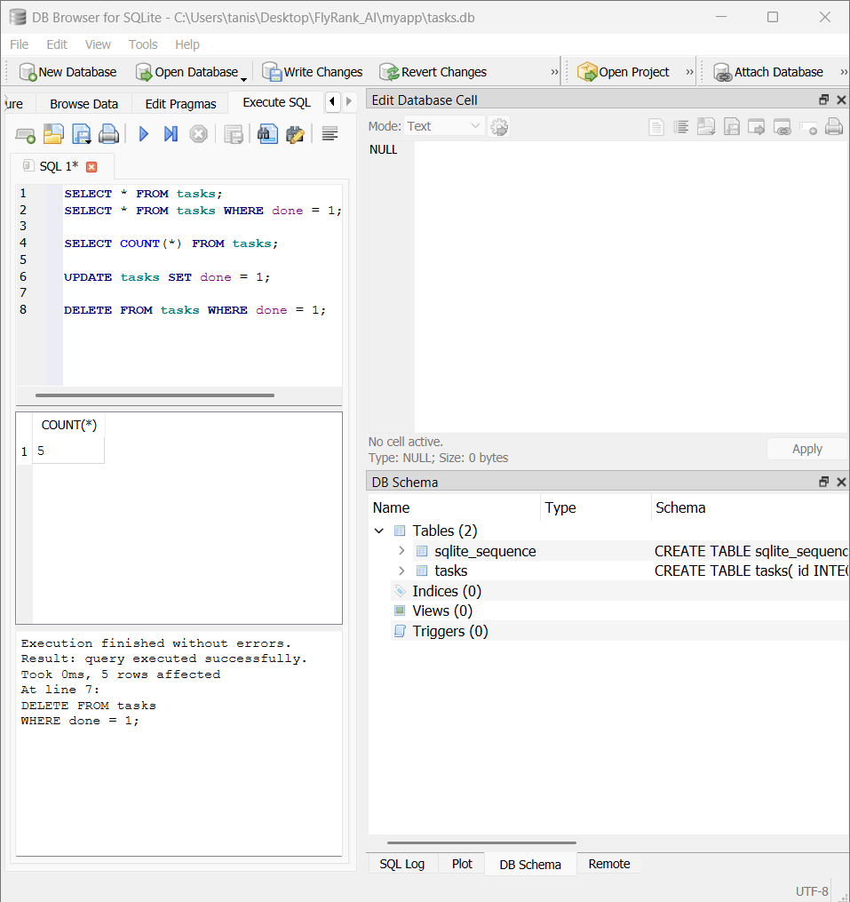

# Task API with SQLite

A REST API built using Node.js, Express.js, and SQLite to manage tasks. The API supports creating, reading, updating, and deleting tasks, with data stored persistently in a local SQLite database. 
-> Commented code is the part from previous assignments' changes, so please ignore them.

## Features

- RESTful CRUD operations for tasks
- SQLite database for persistent storage
- Automatic database and table creation
- Three sample tasks inserted on the first run only
- Input validation and appropriate HTTP status codes
- Swagger UI documentation

## Tech Stack

- Node.js
- Express.js
- SQLite
- better-sqlite3
- Swagger UI Express

## Project Structure

```text
myapp/
├── server.js
├── openapi.json
├── tasks.db
├── README.md
├── database.png
├── .gitignore
├── package.json
└── package-lock.json
```

Note: `tasks.db` is created automatically when the application runs if it does not already exist. `database.png` is the screenshot of the database in DB Browser for SQLite.

## Installation and Setup

1. Clone the repository.
2. Open the project folder in the terminal.
3. Install dependencies:

```bash
npm install
```

4. Start the server:

```bash
node server.js
```

The API runs at:
http://localhost:3000

The database and tasks table are created automatically when the application starts. Three sample tasks are inserted only when the table is empty.

## API Endpoints

| Method | Endpoint | Description | Success Status |
|---|---|---|---|
| GET | `/` | Get API information | 200 |
| GET | `/health` | Check server health | 200 |
| GET | `/tasks` | Get all tasks | 200 |
| GET | `/tasks/:id` | Get a task by ID | 200 |
| POST | `/tasks` | Create a task | 201 |
| PUT | `/tasks/:id` | Update a task | 200 |
| DELETE | `/tasks/:id` | Delete a task | 204 |
| GET | `/docs` | Open Swagger documentation | 200 |

Invalid input returns `400 Bad Request`, while requests for nonexistent tasks return `404 Not Found`.

## Example Requests

### Get all tasks

```bash
curl http://localhost:3000/tasks
```

### Create a task

```bash
curl -X POST http://localhost:3000/tasks -H "Content-Type: application/json" -d "{\"title\":\"Learn SQLite\"}"
```

### Update a task

```bash
curl -X PUT http://localhost:3000/tasks/1 -H "Content-Type: application/json" -d "{\"title\":\"Learn SQLite properly\",\"done\":true}"
```

### Delete a task

```bash
curl -i -X DELETE http://localhost:3000/tasks/1
```

Note: Replace `1` with an existing task ID when necessary.

## Database

The application uses SQLite through `better-sqlite3`. The database file is named `tasks.db` and is stored in the project directory.

The `tasks` table contains:

| Column | Type | Description |
|---|---|---|
| `id` | INTEGER | Unique task ID |
| `title` | TEXT | Task title |
| `done` | BOOLEAN | Task completion status |

SQLite stores Boolean values as integers: `0` represents false and `1` represents true.

### Example SQL Query

```sql
SELECT * FROM tasks;
```

This query retrieves all tasks stored in the database.

### Database Screenshot

The database was inspected using DB Browser for SQLite.



## Data Persistence

Unlike an in-memory array, SQLite stores task data in a database file. Tasks remain available after the server restarts, and the application does not insert duplicate sample tasks every time it starts.

## Running the Project

Clone the repository, install dependencies using `npm install`, and run `node server.js`. The database and table are created automatically if they do not exist.

## Documentation

Swagger UI is available at:
http://localhost:3000/docs

## Learning Outcomes

- Building REST APIs with Express.js
- Performing CRUD operations using SQL
- Integrating SQLite with Node.js
- Validating user input and handling HTTP errors
- Persisting data across server restarts
- Testing SQL queries using DB Browser for SQLite